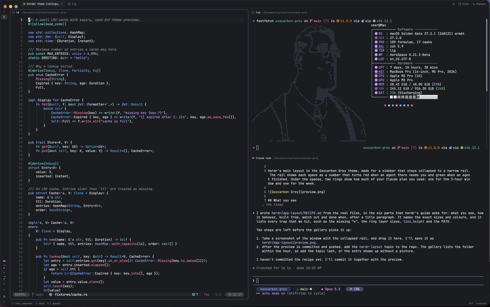

# Oxocarbon Grey

Herdr's main layout in the Oxocarbon Grey theme, made for a sidebar that stays collapsed to a narrow rail. The rail shows each space as a number that turns red when an agent there needs you and green when an agent finished. Under the spaces, two rings show how much of your Claude plan you used: one for the 5-hour window and one for the week. A third ring shows how fast the Claude agent in the focused pane writes, in output tokens per second. An "Open with" menu in the tab bar opens the current folder in Zed, in VS Code or in a Neovim pane.

## What you see

Left to right, top to bottom:

- The sidebar is 268px wide when open and a 76px rail when collapsed (44px off macOS). Its background is `chrome` (`#1b1c1f`).
  - The top is a 46px brand bar from the shipped `workspace-chrome` mod. It holds the traffic lights at (12, 16) and a "+" for a new space.
  - Under it, the spaces list fills the free height. Open, it is the shipped spaces list. On the rail, each space is a 32 by 26px cell with its number in it, with 3px above and below it, so the cells have a 6px gap. The cells have no status dot.
  - Under the spaces, a 160px usage block shows the Claude icon (16px, full colour), then two rings. Each ring is 32px wide, with a 2.5px stroke. The ring has a `border` track (`#26272a`) and an `accent` arc (`#78a9ff`) that starts at 12 o'clock and runs clockwise. The arc length is the percentage used. The percentage is in the middle, in 10px semibold `foreground` (`#dde1e6`). Under each ring is a 9px `dim` (`#6e747d`) label: "5h" for the first ring and "wk" for the second. The icon and the rings have 12px gaps between them.
  - Under it, a 96px TPS block shows a third ring of the same style, 12px under the "wk" label. The arc is the TPS as a share of 150, and the middle shows the TPS as a whole number, with the label "tps".
  - On the rail, a "»" (13px, `dim`) sits under the TPS ring in a 28px row.
  - The bottom is a 69px footer from `workspace-chrome` with the settings and "+" buttons.
- The work area is the shipped main layout: a 42px tab bar with an "Open with" button after Changes, the terminals with 8px padding and 8px gaps on a `canvas` background, a hidden 368px Files and Changes panel on the right, and a 28px status bar.
- "Open with" looks like the Files and Changes buttons: 26px high, 12px `muted` text on `chrome`, with a 12px down chevron. Its popup is 200 by 112px on `popover`, with three 31px rows: Zed, VS Code and "Neovim pane". Each row has a 14px logo tinted `foreground`.
- The whole layout uses the `oxocarbon-grey` theme: background `#1b1c1f`, foreground `#dde1e6`, selection `#2e384c`.

## How it behaves

- On the rail, a space shows its agents' state as a tint on its cell. A space with a blocked agent gets `blocked` (`#ee5396`) at 20% opacity, and a space with a done agent gets `done` (`#42be65`) at 20%. Working and idle spaces have no tint. The selected space has the `selected` fill (`#33353b`) when it has no alert. If it has an alert, the tint rises to 30% in place of the fill. A tinted number is `foreground`, and other numbers are `muted`.
- "done" turns into "idle" once you look at the agent, so the green tint shows only for an agent that finished while you looked elsewhere.
- A click on a space selects it, as in the shipped list. The open sidebar keeps the shipped behaviour.
- The usage numbers load when the block first shows, and then every 5 minutes. A click anywhere on the Claude group refreshes them at once. A hover shows a tooltip such as "Claude / 5-hour: 20%, resets Nov 22 at 3:30am / Week: 8%, resets Nov 28 at 12pm / Click to refresh."
- The TPS ring follows focus. It shows the TPS of the focused terminal's Claude agent, averaged over its current turn: the output tokens of each response in the turn, divided by the time from each request to the end of its response. That time includes the wait for the first token. The number changes after each tool call and at the end of the turn, and it stays after the turn ends. A pane with no Claude turn shows "–". The tooltip gives the TPS and the token count.
- If a load fails, the rings keep the last numbers. If no load has worked yet, each ring is empty with a "–" in the middle, and the tooltip gives the error.
- "Open with" uses the focused terminal's folder, or the space's folder when no terminal has focus. Zed and VS Code open with `open -a`. "Neovim pane" splits the focused pane to the right and runs `zsh -ic v` there, where `v` is an alias for `nvim`. The pane closes when Neovim quits.
- In a space on a remote machine, the Zed and VS Code rows are dim and do nothing, and the Neovim pane runs `nvim` on that machine.
- A click on "»" opens the sidebar to its last width. The open sidebar has no "»". To collapse it, use the sidebar button in the brand bar.

## Built from

- `layouts/oxocarbon-grey.json` is a clone of the shipped `main` layout (`cloned_from` main 0.1.16). It adds `"theme": "oxocarbon-grey"` on the root, and the `tabs` block uses the `oxocarbon-tabs` mod. In `sidebar-lists`, the `spaces` block (weight 1, min 90) uses the `oxocarbon-spaces` mod, and the shipped `agents` block is replaced by a `claude-usage` block (`px` 160) and a `claude-tps` block (`px` 96).
- `mods/oxocarbon-spaces` is a clone of the shipped `spaces` mod. Only `compact()`, the rail cell, changes: an `alert(status)` helper is true for `blocked` and `done`, and the cell's background is `t[status] + "33"`, or `+ "4d"` when the space is active. The cell no longer draws the `glyph()` dot, and `railCell(...)` gets `.py(3)`. The open list is unchanged.
- `mods/oxocarbon-tabs` is a clone of the shipped `tabs` mod. It adds one button after Changes that calls `openOverlay({ mod: "oxocarbon-open-with", kind: "popup", width: 200, height: 112, props: { folder, machine } })`, where `folder` is `focused()?.cwd ?? space.folder`.
- `mods/oxocarbon-open-with` is a new popup mod. Zed and VS Code call `exec("/usr/bin/open", ["-a", app, folder])` and post a `notify` error if it fails. Neovim calls `run("terminal.open", { argv, folder, place: "right" })`. `zed.svg`, `vscode.svg` and `nvim.svg` are the `:zed:`, `:code:` and `:neovim:` glyphs from sketchybar-app-font, saved as SVG paths.
- `mods/claude-usage` is a new mod:
  - `providers.js` lists usage providers. Each provider has an `id`, a `name`, an `icon` path under `~/.config/herdr-app`, and an async `load()` that returns windows (`{ short, name, percent, resets }`). Claude's `load()` runs `claude -p --no-session-persistence /usage` with `exec` and reads the "Current session" and "Current week" lines (`NN% used · resets …`).
  - `main.js` draws each provider: `image(icon)`, then one ring per window. It refreshes with `cx.timer.every(300000)` and `cx.spawn`.
  - `ring.js` draws one ring: a 32px cell with two absolute 32px layers, `svg("mods/claude-usage/rings/ring-track.svg")` tinted `border` and `svg("…/ring-<percent>.svg")` tinted `accent`, then the text on top and the label under it.
- `mods/claude-tps` is a new mod:
  - `tps-hook.py` is a Claude Code hook for the async `PostToolUse` and `Stop` events. It exits at once when `HC_TERMINAL_ID` is not set. It reads only the last 512 KB of `transcript_path`, finds the last prompt, and groups the assistant entries by message id. Each response starts at the entry before its first block and ends at its last block. It writes `{ tps, tokens }` to `data/claude-tps/terminals/<HC_TERMINAL_ID>.json` in the herdr-app folder, through a temporary file and a rename. One run takes about 25 ms.
  - `install-tps-hook.py` adds the hook to `~/.claude/settings.json` in exec form (`command` `python3`, `args` the hook path in herdr-app's `mods/claude-tps`), and `--remove` takes it out. It keeps other hooks, makes a backup only when it changes the file, and creates the `terminals` folder.
  - `main.js` reads the TPS files with `readTextFile` and waits for changes with `watchFolder` on the `terminals` folder, so it does no polling. `focused().terminal` picks the file. It draws the ring with `ring.js`, an exact copy of the one in `claude-usage`, and uses the ring SVGs in `mods/claude-usage/rings`. It also keeps the shipped agents mod's `narrow()` rule (sidebar under 160px) and its `toggleSidebar()` for "»", because its block is the last one above the footer.
  - `rings/` holds `ring-track.svg` and `ring-0.svg` to `ring-100.svg`: one circle each, r 14.25 in a 32 by 32 view box, with a round line cap and a `stroke-dasharray` for the percentage, rotated -90°. `make-rings.mjs` writes them with `node make-rings.mjs`.
- The shipped mods it uses are `workspace-chrome` (brand bar and footer), `pane`, `files`, `changes` and `workspace-status`.
- `herdr` functions: `theme`, `layout`, `run` (`space.select`, `layout.resize`), `shared` and `setShared` (`sidebar.width`, `sidebar.collapsed`), `window`, `exec`, `home`, `appHome`, `readTextFile`, `watchFolder`, `focused`, `openOverlay`, `closeOverlay`, `notify`, `run` (`terminal.open`).
- Programs: `claude` (Claude Code, logged in with a Claude plan), `hc` from the shipped spaces code, Zed, VS Code, `zsh` and `nvim`. Change `nvim` in `oxocarbon-open-with/main.js` if you have no `v` alias.

## Watch out

- herdr replaces its shipped layouts and mods on every start. Clone `main` and `spaces` with `layout.clone` and `mod.clone`, and do not edit them in place.
- The "»" that expands the rail belongs to the shipped agents mod, and this layout moves it into `claude-tps`. If you remove the `claude-tps` block, you must draw the "»" somewhere else, or the rail cannot open except through the brand bar on platforms that show its button.
- herdr draws SVGs only from files, so the ring needs one file per percentage. herdr tints the shapes with the text colour, so the stroke colour in the files does not matter.
- Give each absolute ring layer its own 32px size. Without it, the layers do not line up with the number on top.
- `line_height` takes a string such as `"12px"`. A bare number counts as a multiplier.
- A GUI app's PATH often lacks `~/.local/bin`, where the Claude Code installer puts `claude`. The mod tries `claude` first and then `~/.local/bin/claude`.
- Without `--no-session-persistence`, each refresh leaves a session file in `~/.claude/projects`.
- `/usage` runs locally and makes no model call, but its text can change in a later Claude Code release. If it does, the windows show "–", and `windowFrom()` in `providers.js` needs a new pattern.
- The 160px usage block fits one provider with two windows. Each extra provider needs about 100px more.
- The numbers are the percentage used, not the percentage left.
- A Claude Code session reads its hooks when it starts, so restart sessions after you install the hook.
- The transcript has no time for the first streamed token, so the TPS counts the wait before it. Short responses after a tool call show a lower TPS than the model's streaming speed.
- herdr does not let a mod import a file from another mod's folder, so `claude-tps` has its own copy of `ring.js`. Change both copies together. `claude-tps` needs `claude-usage` installed for the ring SVGs.
- If the `terminals` folder does not exist when the mod starts, the watch fails and the ring stays empty until herdr-app restarts. The installer creates the folder.
- A GUI app's PATH often lacks `/opt/homebrew/bin` and `/usr/local/bin`, so the `zed` and `code` commands can fail there. `open -a` finds the apps by name.
- `props()` is null when `herdr-app check` renders a popup mod, so give it a default.

## Done when

- `herdr-app check` passes for `mods/oxocarbon-spaces`, `mods/oxocarbon-tabs`, `mods/oxocarbon-open-with`, `mods/claude-usage` and `mods/claude-tps`.
- After `layout.switch {"name":"oxocarbon-grey"}`, the window uses the Oxocarbon Grey colours.
- On the rail, no space shows a dot. A space whose agent asks a question gets a red tint, and a space whose agent finishes while you look at another space gets a green tint.
- The usage block shows the Claude icon and two rings with the same numbers as `/usage` in Claude Code.
- A click on the Claude group refreshes the numbers, and the hover tooltip shows both reset times.
- A click on "»" opens the sidebar to its last width.
- After a tool call in a Claude pane, the TPS ring shows a number. A focus change to another Claude pane shows that pane's number, and a focus change to a shell shows "–".
- "Open with" opens the focused terminal's folder in Zed, in VS Code, or in Neovim in a new pane on the right.
